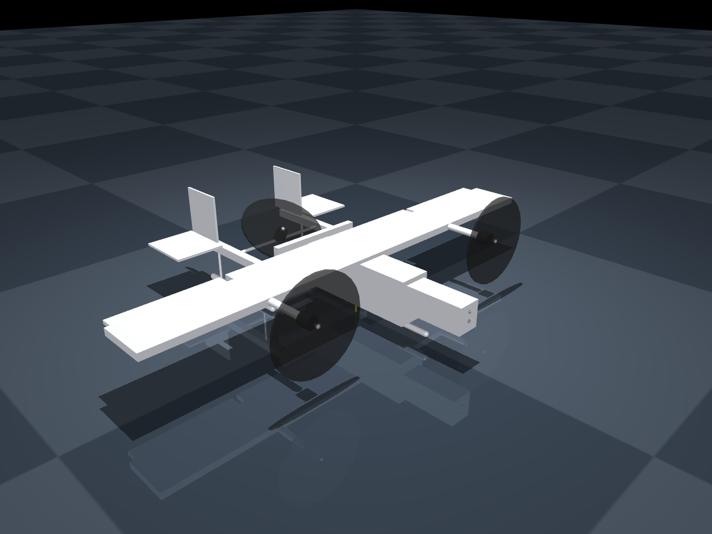

# tri-tiltrotor-vtol

Tilt-tri-rotor VTOL delivery drone built in simulation: parametric MuJoCo model, physics for
motors, servos and aerodynamics, a cascaded PID controller that flies the hover-to-wing
transition, PPO residual RL policies, a browser ground station for RC-style or autonomous
delivery flights, and a full electronics design.

*Status: simulation, control and RL are complete. Building and
flight-testing the real aircraft is the next phase — see [HARDWARE_BUILD.md](HARDWARE_BUILD.md).*



## What is in here

| Part | What it does | Where |
|---|---|---|
| Vehicle model | 3.53 kg, 1.6 m span, two tilting wing motors (0–90°) + tilting tail motor (0–30°), 9 actuators; generated from one parameter file | `model/`, `params/params.yaml` |
| Physics | motor lag + thrust decay with inflow, battery sag, servo rate/backlash, 6-station wing aerodynamics with stall, slipstream, wind gusts, sensor noise | `sim/` |
| Baseline controller | cascaded PID (position → velocity → attitude → rate), hover/cruise mixers, scripted transition and back-transition | `control/` |
| Reinforcement learning | Gymnasium env, PPO residual policies on top of the baseline (hover, waypoints, obstacle avoidance), ONNX export | `rl/`, `policies/` |
| Ground station | browser cockpit streamed from the live sim: Mode-2 sticks (screen, keyboard, phone or USB RC transmitter), manual and autonomous delivery modes | `gcs/` |
| Electronics design | block diagram, pin map, wiring rules, parts list, power budget, failsafes | `hardware/` |
| Report | design, results (including what did not work), 20-question FAQ, decision log | `docs/` |

**Results at a glance** (all regenerate from the commands below):
calm-air mission altitude deviation 2.98 m (< 3 m) and landing error 0.22 m (< 1 m);
autonomous 427 m delivery round trip lands 0.04 m from the pad and 0.08 m from home;
RL hover residual cuts tracking error by 26 %. Not met: RL success thresholds (hover 86 % vs
≥ 95 %, obstacles 8 % vs ≥ 85 %) and baseline wind tolerance above 3 m/s — diagnosed in
[docs/report.md](docs/report.md) §4–5.

Videos: [full mission](docs/videos/mission_calm.mp4) ·
[RL hover](docs/videos/rl_hover_s1.mp4) ·
[obstacles: baseline](docs/videos/baseline_obstacle.mp4) vs
[RL](docs/videos/rl_obstacle_G_seed10001.mp4)

---

## Requirements

| | Minimum | Tested with |
|---|---|---|
| OS | Ubuntu 22.04+ (native), or Windows 10/11 with WSL2 | Windows 11 + WSL2 Ubuntu 26.04 |
| Python | 3.11 | 3.11.18 (conda-forge) |
| CPU / RAM | 4 cores, 8 GB | 6 parallel envs, ~3 GB RAM while training |
| GPU | not needed (simulation is CPU-bound) | RTX 4050 6 GB used for PPO updates |
| Disk | ~6 GB (PyTorch + CUDA libraries) | |
| Browser | any modern browser (Chrome/Edge/Firefox/Safari, desktop or phone) | Chrome, Edge |

**Why WSL2 on Windows:** MuJoCo, NumPy and PyTorch load native libraries that Windows *Smart
App Control* may block; Linux avoids it and gives headless (EGL) rendering. Native Linux works
the same way. macOS should run the simulation but offscreen video rendering (EGL) is untested.

### Python dependencies (pinned in `requirements.txt`)

| Package | Version | Used for |
|---|---|---|
| mujoco | 3.17.0 | physics engine, rendering |
| numpy / scipy | 2.4.6 / 1.17.1 | maths, trim solver |
| gymnasium | 1.4.0 | RL environment API |
| stable-baselines3 | 2.9.2 | PPO training |
| torch | 2.15.0 | neural networks (installed by SB3) |
| tensorboard | 2.21.0 | training curves |
| onnx / onnxruntime-gpu | 1.23.2 / 1.31.1 | policy export and inference (CPU works) |
| websockets / pillow | 17.4 / 13.0.0 | ground-station server, JPEG video stream |
| matplotlib / pandas | 3.11.2 / 3.1.1 | plots, metrics tables |
| PyYAML / pytest | 6.0.3 / 9.2.0 | parameters, tests |

System tools: **ffmpeg** (videos), **git**.

---

## Installation

### Option A — Windows 10/11 (WSL2)

1. **Install WSL2 with Ubuntu** — in *PowerShell as Administrator*:
   ```powershell
   wsl --install -d Ubuntu
   ```
   Restart when asked, then open **Ubuntu** from the Start menu and create a user name/password.
2. Continue with **Option B** inside the Ubuntu window. Keep the project inside the Linux home
   folder (`~/`) for speed, or on `C:` (reachable as `/mnt/c/...`).

### Option B — Ubuntu / WSL2 terminal

1. **Get the code**
   ```bash
   sudo apt update && sudo apt install -y git
   git clone https://github.com/Absurd28/tri-tiltrotor-vtol.git
   cd tri-tiltrotor-vtol
   ```
2. **Install Miniconda** (no admin rights needed; downloads the official installer, then runs it)
   ```bash
   wget https://repo.anaconda.com/miniconda/Miniconda3-latest-Linux-x86_64.sh -O ~/miniconda.sh
   bash ~/miniconda.sh -b -p ~/miniconda3
   ```
3. **Create the Python 3.11 environment and ffmpeg**
   ```bash
   ~/miniconda3/bin/conda create -n drone311 -c conda-forge python=3.11 ffmpeg -y
   ```
   (If conda asks you to accept its terms of service, run the `conda tos accept ...` command it prints.)
4. **Put the environment first on your PATH** (do this in every new terminal, or add the line to `~/.bashrc`)
   ```bash
   export PATH="$HOME/miniconda3/envs/drone311/bin:$PATH"
   ```
   This is more reliable than `conda activate` when the Windows PATH (with spaces) is shared into WSL.
5. **Install the Python packages**
   ```bash
   python -m pip install -r requirements.txt
   ```
6. **Check the installation**
   ```bash
   python -c "import mujoco, stable_baselines3, onnxruntime; print('OK', mujoco.__version__)"
   pytest -m "not slow"          # ~60 tests, about 30 s
   python scripts/check_model.py # ALL CHECKS PASS
   ```

Optional GPU check (training also works on CPU):
```bash
python -c "import torch; print(torch.cuda.is_available())"
```

---

## Quick start

**Fly the drone** (ground station):
```bash
bash scripts/run_gcs.sh
```
Open **http://localhost:0000**. Arm (SA), push the left stick up to climb, use the right stick to
fly. Switch SB to AUTO and click the map for an autonomous delivery. Controls, phone setup and
the delivery mission are explained in [gcs/README.md](gcs/README.md) and
[docs/GUIDE.md](docs/GUIDE.md).

**Look at the model in 3D** (needs a display; WSLg on Windows 11 provides one):
```bash
python scripts/viewer_tilt.py      # keys Q/A, W/S, E/D tilt the motors; Z hover, X cruise
```

**Fly the full baseline mission and plot it:**
```bash
python eval/run_mission.py --tag calm
```

## Reproduce every result in the report

Seeds are fixed; each command regenerates one table or figure.

```bash
python scripts/check_model.py                       # model acceptance (mass/CG/inertia/clearance)
MUJOCO_GL=egl python scripts/render_views.py        # docs/renders/*.png
pytest -m "not slow"                                # physics, env, ground-station, hardware tests
pytest                                              # + full missions (slow, ~5 min)
python control/trim.py                              # eval/trim_table.csv, eval/tilt_corridor.png
python eval/run_mission.py --tag calm               # eval/baseline_metrics.csv + plot
python eval/run_mission.py --tag cg0.02 --cg-shift 0.02
python eval/run_mission.py --tag wind3 --wind 3     # completes
python eval/run_mission.py --tag wind5 --wind 5     # fails (known limitation, report §4)
MUJOCO_GL=egl python eval/run_mission.py --tag video --video docs/videos/mission_calm.mp4

# RL training (~1 M steps per stage, a few hours each on a laptop)
python rl/train.py --task hover    --steps 1000000 --name s1_hover    --dr --log-std-init -2.3 --lr 1e-4
python rl/train.py --task waypoint --steps 1000000 --name s2_waypoint --dr --log-std-init -2.3 --lr 1e-4 --init runs/s1_hover/final.zip
python rl/train.py --task obstacle --mode G --steps 1000000 --name s5_obstacle_G --dr --difficulty 0.4 --log-std-init -1.0 --lr 3e-4
python rl/select_checkpoint.py --name s1_hover --task hover          # best checkpoint on validation seeds
python rl/select_checkpoint.py --name s2_waypoint --task waypoint --stride 2
python rl/select_checkpoint.py --name s5_obstacle_G --task obstacle --mode G --difficulty 0.4
bash scripts/evaluate_all.sh                        # eval/rl_metrics.csv (50 test episodes per row)
python rl/export_onnx.py runs/s1_hover/best.zip     # ONNX + parity check
python hardware/power_budget.py                     # electrical budget tables
```

The trained policies used in the report are included as `policies/*.onnx`; the ground station
uses `policies/s1_hover.onnx` when no `runs/` folder exists.

## Repository layout

```
params/     vehicle parameters (single source of truth, [measured]/[estimated]/[assumed] tags)
model/      MJCF generator and generated model
sim/        motor, battery, servo, aerodynamics, wind, sensors, vehicle
control/    PID, mixer, baseline controller, trim solver
rl/         Gymnasium env, obstacles, domain randomisation, training, evaluation, ONNX export
policies/   trained policies (ONNX) selected on validation seeds
gcs/        ground station: real-time simulation server + browser cockpit
hardware/   electronics: block diagram, BOM, power budget, pin map
eval/       mission runner, metrics CSVs, plots
docs/       report, decision log, step-by-step guide, renders, videos
tests/      pytest suite (69 tests + 1 documented expected failure)
scripts/    viewers, renders, evaluation and launch helpers
```

## Conventions

World frame ENU (x east, y north, z up); body frame FLU (x forward, y left, z up); SI units;
nacelle tilt 0° = thrust up (hover), 90° = thrust forward (cruise).

## Documentation

- [docs/report.md](docs/report.md) — the project report (results, limitations, FAQ)
- [docs/DECISIONS.md](docs/DECISIONS.md) — every design decision with its reason
- [docs/GUIDE.md](docs/GUIDE.md) — step-by-step: see the circuitry, model, simulation; fly from PC or phone
- [hardware/README.md](hardware/README.md) — electronics design
- [HARDWARE_BUILD.md](HARDWARE_BUILD.md) — build guide and where to buy the parts
- [gcs/README.md](gcs/README.md) — ground station controls

## Safety

Everything here is simulation. Aerodynamic and propulsion parameters are estimates (±30 %)
until bench-tested; nothing in this repository shows that a real aircraft built from it is safe
to fly. Follow the bring-up checklist and local drone regulations before any flight.
