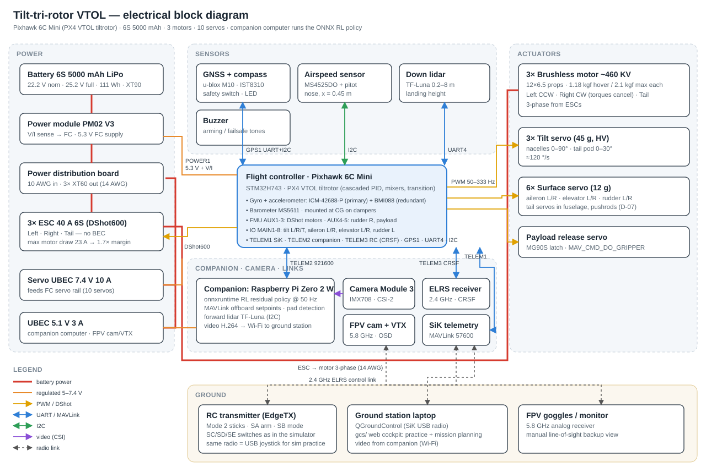

# Electronics & circuitry — tilt-tri-rotor VTOL

Complete electrical design for the vehicle simulated in this repository. **Status: design only,
not yet built or bench-tested** (Phases 9–10, next semester). Part names are *examples* of the
right class; any equivalent with the same interface, voltage and current rating works. Check every
datasheet before ordering. All numbers below regenerate with `python hardware/power_budget.py`
and are checked by `tests/test_hardware.py`.

## 1. Architecture in one paragraph

A **6S 5000 mAh LiPo** feeds a **power module** (current/voltage sensing + clean 5.3 V for the
flight controller) and a **power distribution board** that supplies three **40 A ESCs** driving
the two tilting wing motors and the tail motor. Two separate **UBECs** make 7.4 V for the ten
servos (3 tilt, 6 control surfaces, 1 payload latch) and 5.1 V for the companion computer and
cameras, so servo current spikes never brown out the computers. The **Pixhawk 6C Mini** flight
controller holds the attitude/rate loops and the transition logic (PX4 *VTOL tiltrotor*), using
its **gyroscopes and accelerometers** (ICM-42688-P primary, BMI088 redundant), barometer, GNSS +
compass, airspeed sensor and a downward lidar. A **Raspberry Pi Zero 2 W** companion computer
runs the trained **RL residual policy** (the ONNX file exported by `rl/export_onnx.py`) at 50 Hz
and the **Camera Module 3** for pad detection, and talks to the FC over MAVLink. The pilot flies
with an **ExpressLRS** RC link; a **SiK telemetry radio** links QGroundControl.

## 2. Flight-controller pin map (Pixhawk 6C Mini)

| FC port | Connected to | Signal | Notes |
|---|---|---|---|
| FMU AUX1 | ESC left wing motor | PWM 400 Hz (DShot600 with a BLHeli_32 ESC) | motor 1, **CCW** (prop_spin +1) |
| FMU AUX2 | ESC right wing motor | PWM 400 Hz (or DShot600) | motor 2, **CW** |
| FMU AUX3 | ESC tail motor | PWM 400 Hz (or DShot600) | motor 3 |
| FMU AUX4 | Rudder servo right | PWM 50 Hz | mirrors rudder left |
| FMU AUX5 | Payload release servo | PWM 50 Hz | PX4 gripper function |
| FMU AUX6 | spare | — | |
| IO MAIN1 | Tilt servo left nacelle | PWM 333 Hz | 0° = hover, 90° = cruise |
| IO MAIN2 | Tilt servo right nacelle | PWM 333 Hz | |
| IO MAIN3 | Tilt servo tail pod | PWM 333 Hz | 0–30° |
| IO MAIN4 / 5 | Aileron left / right | PWM 50 Hz | opposite deflection |
| IO MAIN6 / 7 | Elevator left / right | PWM 50 Hz | same deflection |
| IO MAIN8 | Rudder left | PWM 50 Hz | |
| Servo rail + / − | Servo UBEC 7.4 V | power | **only** servo power source |
| POWER1 | Power module PM02 V3 | 5.3 V + analog V/I | |
| GPS1 | M10 GNSS + compass + safety switch | UART + I2C | mast above wing |
| I2C | MS4525DO airspeed | I2C | pitot at the nose |
| GPS2 / UART4 | TF-Luna down lidar | UART 115200 | landing height |
| TELEM1 | SiK telemetry radio | MAVLink 57600 | QGroundControl |
| TELEM2 | Raspberry Pi Zero 2 W (GPIO14/15) | MAVLink 921600 | RL policy, offboard |
| TELEM3 | ELRS receiver | CRSF 420k | RC input + link stats |
| BUZZER | Buzzer | — | |

The 3-motor + 9-actuator layout is exactly the 9-dimensional action space of the simulator
(`u = [thr L, thr R, thr T, tilt L, tilt R, tilt T, aileron, elevator, rudder]`); the FC mixer
splits the 3 virtual surfaces into the 6 physical servos the same way `Vehicle._surface_map` does.

## 3. Power budget and wiring

Estimated from momentum theory (figure of merit 0.6), motor efficiency 0.75 and the simulated
L/D of 8 at 17 m/s — see `hardware/power_budget.py` for the method:

| Condition | Power | Battery current | Endurance (80 % usable) |
|---|---|---|---|
| Hover (all 3 motors + avionics + servos) | 638 W | 28.7 A | 8.4 min |
| Cruise 17 m/s (wing motors, L/D 8) | 176 W | 7.9 A | 30 min (~31 km) |
| One motor at max thrust (2.1 kgf) | 491 W | 23.3 A | — |
| Peak: 3 motors max + servos slewing | 1528 W | 68.8 A | — |

| Check | Value | Requirement | Result |
|---|---|---|---|
| ESC rating / max motor current | 40 A / 23.3 A | ≥ 1.5× | ✓ 1.72× |
| Servo UBEC / peak servo current | 10 A / 6 A | ≥ 1.5× | ✓ 1.67× |
| Battery burst (45C) / peak current | 225 A / 69 A | ≥ 2× | ✓ 3.3× |
| Thrust-to-weight | 1.79 | ≥ 1.6 for VTOL | ✓ |

The hover endurance (8 min) is why the mission design keeps hover phases short and does the
distance on the wing. Measured in the simulator (`gcs/sim_core.py`, calm air): a 427 m delivery
round trip takes 217 s and uses **22.7 %** of the battery, most of it in the four vertical
phases (2 take-offs, 2 landings) and the precision approaches; a 50 m multicopter hop round trip
uses 12.8 %. Rough radius estimate: ≈ 22 % fixed overhead per round trip + ≈ 2.6 % per km
on the wing (176 W at 17 m/s) leaves (70 % − 22 %) / (2 × 2.6 %/km) ≈ 9 km with a 30 % reserve —
an estimate only; the ground station caps missions at 2.5 km.

**Wiring rules**
- Battery → PM → PDB: **10 AWG** silicone, XT90 (peak ≈ 69 A). The PM02 V3 is rated 60 A continuous / 100 A burst, but its pre-soldered XT60 lead only 30 A — replace the lead and connectors before flight. PDB → ESCs: **14 AWG**, XT60.
- ESC leads as short as possible; 25 V 470 µF low-ESR capacitor at each ESC input (long leads
  through the tilting nacelle hinge add inductance → voltage spikes).
- Nacelle hinge: motor phase wires pass through a service loop with strain relief; the loop must
  allow the full 0–90° tilt without pulling (check by sweeping the servo by hand before power-up).
- Signal leads twisted with their ground; GNSS cable away from ESC/battery leads, ferrite bead.
- Servo UBEC output goes **only** to the FC servo rail; never connect a second 5 V source to
  the rail. The FC itself is powered by the PM (and USB on the bench).
- Companion computer from its own 5.1 V UBEC; ground shared with the FC through the TELEM2 cable.

## 4. Mass check

All electronics come out of the airframe mass budget in `params/params.yaml`:

| Mass budget line | BOM total | params.yaml budget | Δ |
|---|---|---|---|
| battery | 700 g | 700 g | +0.0 % |
| motors | 450 g | 420 g | +7.1 % |
| escs | 90 g | 90 g | +0.0 % |
| tilt_servos | 135 g | 135 g | +0.0 % |
| surface_servos | 72 g | 72 g | +0.0 % |
| avionics_sensors | 289 g | 270 g | +7.0 % |

Motors (+30 g, the 150 g MN4014) and avionics (+19 g, mostly the 35 g servo UBEC) are each ~7 % over their budget lines — inside the ±10 % tolerance of the mass acceptance, but the next model iteration should update `params.yaml` to the measured masses.
A Raspberry Pi 5 instead of the Zero 2 W (for heavier vision) would add ~60 g; a 360° scanning
lidar (RPLIDAR C1, 110 g) to match the simulator's 8 horizontal range rays exactly would push the
avionics line 40 % over budget — that trade-off is why the hardware carries one forward lidar +
the camera, and is listed as a sim-to-real gap below.

Full parts list with interfaces: [`bom.csv`](bom.csv).

## 5. Simulation ↔ hardware mapping

| Simulator | Hardware | Gap to close in Phases 9–10 |
|---|---|---|
| `sim/motor.py` kT, lag 70 ms, thrust decay | motor + 12×6.5 prop on 40 A ESC | thrust-stand: kT, kQ, lag, current vs throttle |
| `sim/servo.py` 120 °/s, 50 ms lag, backlash | 45 g tilt / 12 g surface servos | measure rate under load, backlash at the nacelle |
| IMU noise + bias walk (`sim/sensors.py`) | ICM-42688-P gyro/accel | Allan variance from a static log |
| baro, pitot lag, 10 Hz GPS | MS5611, MS4525DO, u-blox M10 | calibrate airspeed ratio in flight |
| `range_down` site | TF-Luna down | — |
| 8 horizontal range rays (RL obstacle obs) | 1 forward TF-Luna + camera | either scanning lidar (mass) or retrain with a forward-only observation |
| battery OCV + IR sag | 6S 5000 mAh | discharge test → OCV curve and R |
| RL policy (`runs/*/final.onnx`) | onnxruntime on Pi Zero 2 W | timing test: 50 Hz with MAVLink round-trip < 10 ms |
| baseline controller (`control/`) | PX4 VTOL tiltrotor + tuning | port gains; baseline stays the safety fallback |

## 6. Failsafes (PX4 parameters to set before first flight)

| Event | Action | Parameter(s) |
|---|---|---|
| RC link lost > 1 s | Return-to-land (hover regime) / RTL (wing-borne) | `COM_RC_LOSS_T`, `NAV_RCL_ACT` |
| Telemetry lost | continue mission | `NAV_DLL_ACT` = 0 |
| Battery low 30 % / critical 20 % | RTL / land now | `BAT_LOW_THR`, `BAT_CRIT_THR`, `COM_LOW_BAT_ACT` |
| Companion (RL) heartbeat lost | baseline controller only (residual = 0) | offboard loss: `COM_OBL_RC_ACT` |
| Transition timeout / airspeed failure | abort to hover | `VT_TRANS_TIMEOUT`, `ASPD_DO_CHECKS` |
| Geofence breach | RTL | `GF_ACTION`, `GF_MAX_HOR_DIST` |

The RL residual is bounded (±25 % throttle/tilt, ±50 % surfaces, same as `rl/env.py`) and is
added on top of the baseline controller; if the companion stops sending, the FC flies the
baseline alone. This "baseline as supervised fallback" is the deployment story from viva Q15.

## 7. Bring-up checklist (props OFF until step 8)

1. Continuity/short check battery + to −, PDB outputs, UBEC outputs (multimeter).
2. Power from a current-limited bench supply at 22 V, 2 A: FC boots, no smoke, UBEC rails 7.4 V / 5.1 V.
3. Flash PX4, select VTOL tiltrotor airframe; set outputs per §2; calibrate accelerometer, gyro, compass, level horizon, airspeed.
4. Servo directions and travel: tilt 0°/90° match the hover/cruise marks; surfaces move as in `Vehicle._surface_map`.
5. ESC calibration not needed (DShot); check motor order and spin direction (left CCW, right CW).
6. RC: channels, switches SA–SE as in the simulator cockpit (`gcs/`), failsafe test by switching the transmitter off.
7. Companion: MAVLink heartbeat over TELEM2, RL policy timing ≥ 50 Hz, kill the process → FC continues on baseline.
8. Props on, tethered hover test; then free hover; transitions only after hover tuning is complete.

Never state or assume a flight is safe from simulation alone: the parameters are ±30 %
estimates until the bench tests above are done.
